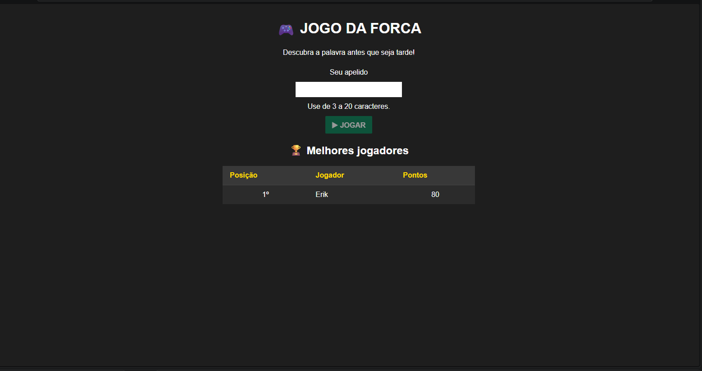

# Forca Dev

Jogo da forca com palavras de tecnologia, desenvolvido por Erik Cabral.
O jogador informa um apelido, tenta descobrir a palavra e pode entrar
no ranking das dez melhores vitórias.

## Tecnologias

- React e TypeScript na interface
- Vite para desenvolvimento e compilação da interface
- Node.js, Express e TypeScript na API
- SQLite com better-sqlite3 para persistência
- Zod para validação
- Vitest e Supertest para testes automatizados

## Pré-requisitos

- Node.js 24 LTS com npm
- Git para clonar o repositório

## Preparar o projeto

Clone o repositório e abra a pasta `forca-erik`.

No terminal da raiz, instale as dependências da interface:

```powershell
npm.cmd ci
```

Depois instale as dependências do servidor e cadastre as palavras:

```powershell
cd backend
npm.cmd ci
npm.cmd run seed
```

O seed cria o arquivo `backend/forca.db` e cadastra 20 palavras
em três categorias. Pode ser executado novamente sem duplicar palavras.

## Executar

No terminal da pasta `backend`, inicie a API:

```powershell
npm.cmd run dev
```

A API fica disponível em http://localhost:3333.

Abra outro terminal na raiz `forca-erik` e inicie a interface:

```powershell
npm.cmd run dev
```

Abra o endereço mostrado pelo Vite, normalmente http://localhost:5173.
Mantenha os dois terminais executando durante o jogo.

## Como jogar

1. Informe um apelido de 3 a 20 caracteres.
2. Clique em Jogar.
3. Escolha letras pelo teclado virtual.
4. Cada letra errada consome uma das 6 vidas.
5. Descubra a palavra antes que as vidas acabem.
6. Ao terminar, confira a palavra, os pontos e o ranking.

Uma letra repetida é rejeitada sem consumir vida.
Partidas encerradas rejeitam novos palpites.

## Pontuação e ranking

Na vitória, a pontuação é calculada por:

vidas restantes × 10 + letras distintas da palavra × 5

Na derrota, a pontuação é zero.

O ranking mostra as dez vitórias com mais pontos.
Em caso de empate, quem terminou primeiro aparece à frente.

## Palavra secreta

O servidor sorteia a palavra no SQLite e processa os palpites.
Durante a partida, a API envia a máscara e mantém o campo
`palavra` como `null`. A palavra é revelada quando a partida termina.

## Rotas da API

| Método | Caminho | Finalidade |
|---|---|---|
| POST | /api/partidas | Criar partida |
| GET | /api/partidas/:id | Consultar partida |
| POST | /api/partidas/:id/palpites | Enviar palpite |
| GET | /api/ranking | Consultar ranking |

## Testes e checagem de tipos

No terminal da pasta `backend`:

```powershell
npm.cmd run typecheck
npm.cmd test
```

Foram implementados 12 testes automatizados.
Os testes da API usam SQLite em memória, configurado no
`backend/vitest.config.ts`.

Para conferir os tipos e compilar a interface, execute na raiz:

```powershell
npm.cmd run build
```

## Documentação

- `docs/planejamento.md` — banco, tipos e ordem de implementação
- `docs/api.md` — contrato das rotas e exemplos
- `docs/decisoes.md` — decisões técnicas
- `docs/diario-de-bordo.md` — atividades e consultas por aula

## Tela do jogo

